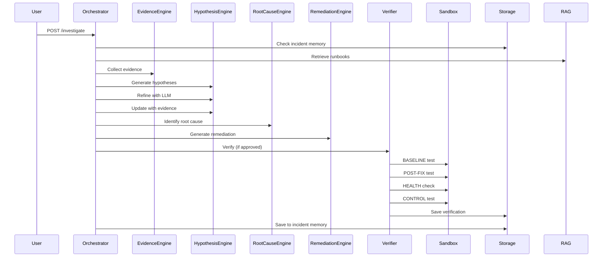
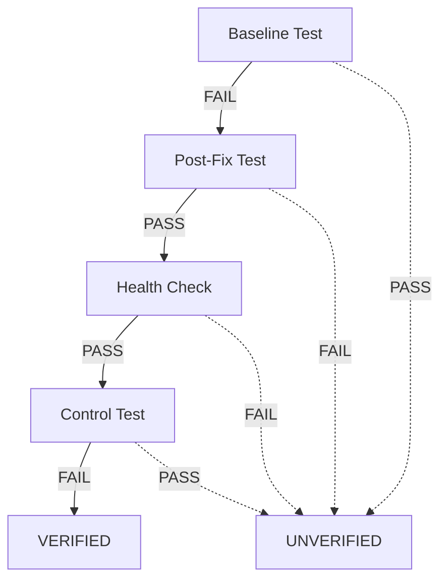

# ARCHITECTURE.md - COSKA System Architecture

## System Overview

```
┌─────────────────────────────────────────────────────────────────────────────────┐
│                              COSKA ARCHITECTURE                                  │
│                                                                                  │
│  ┌──────────────────┐    ┌──────────────────┐    ┌──────────────────────────┐  │
│  │   Frontend       │    │    Backend       │    │      External           │  │
│  │  (React + TS)    │◄──►│   (FastAPI)      │◄──►│   Nebius Token Factory  │  │
│  │                  │    │                  │    │   (NVIDIA Nemotron)     │  │
│  │  Dashboard       │    │  Orchestrator    │    │                          │  │
│  │  Investigation   │    │  (8 phases)      │    │  Tavily Search API      │  │
│  │  Judge Mode      │    │                  │    │  (Web Research)         │  │
│  │  Knowledge Base  │    │  Agent Engines   │    │                          │  │
│  │  Service Map     │    │  • Evidence      │    │                          │  │
│  │  Voice Assistant │    │  • Hypotheses    │    │                          │  │
│  │                  │    │  • Root Cause    │    │                          │  │
│  │  Components:     │    │  • Remediation   │    │                          │  │
│  │  Layout, Cards,  │    │  • Verifier      │    │                          │  │
│  │  Graphs, Forms   │    │  • Planner       │    │                          │  │
│  └──────────────────┘    └────────┬─────────┘    └──────────────────────────┘  │
│                                   │                                           │
│                    ┌──────────────▼──────────────┐                            │
│                    │      Provider Abstraction   │                            │
│                    │  ┌──────────────────────┐   │                            │
│                    │  │ MockAIProvider       │   │                            │
│                    │  │ (Default, Offline)   │   │                            │
│                    │  └──────────────────────┘   │                            │
│                    │  ┌──────────────────────┐   │                            │
│                    │  │ NebiusTokenFactory   │   │                            │
│                    │  │ Provider (Live)      │   │                            │
│                    │  └──────────────────────┘   │                            │
│                    └──────────────┬──────────────┘                            │
│                                   │                                           │
│                    ┌──────────────▼──────────────┐                            │
│                    │        Tool Registry        │                            │
│                    │  ┌──────────────────────┐   │                            │
│                    │  │ 6 Inspection Tools   │   │                            │
│                    │  │ (Logs, Config,       │   │                            │
│                    │  │  Deployment, Runtime, │   │                            │
│                    │  │  Repository, Web)    │   │                            │
│                    │  └──────────────────────┘   │                            │
│                    └──────────────┬──────────────┘                            │
│                                   │                                           │
│                    ┌──────────────▼──────────────┐                            │
│                    │         Sandbox             │                            │
│                    │  ┌────────────┐ ┌────────┐  │                            │
│                    │  │ LocalSafe  │ │ Docker │  │                            │
│                    │  │ (Subprocess)│ │ (Container)│                          │
│                    │  └────────────┘ └────────┘  │                            │
│                    └──────────────┬──────────────┘                            │
│                                   │                                           │
│                    ┌──────────────▼──────────────┐                            │
│                    │       Persistence           │                            │
│                    │  SQLite + SQLAlchemy (Async)│                            │
│                    │  • Incidents, Evidence,     │                            │
│                    │    Hypotheses, Remediations,│                            │
│                    │    Verifications, Actions,  │                            │
│                    │    Memory, Audit            │                            │
│                    └─────────────────────────────┘                            │
└─────────────────────────────────────────────────────────────────────────────────┘
```

## Core Principle

```
LLM REASONS
TOOLS ACT
VERIFIER DECIDES
```

- **LLM** (via Provider Abstraction): Reasoning, synthesis, hypothesis generation, root cause analysis, remediation planning
- **Tools** (via Tool Registry): Deterministic inspection actions (logs, config, deployment, runtime, repository, web search)
- **Verifier** (Deterministic): 3-stage causal verification - ONLY authority for VERDICT

---

## Component Architecture

### Frontend (React + TypeScript + Vite)

#### State Management
- **Local component state** (useState/useEffect) - No global store
- **React Router** for navigation state
- **Polling** (5s interval) for investigation progress

#### Component Hierarchy
```
App.tsx
├── Layout.tsx (Header + Navigation)
│   ├── Dashboard (/) - KPIs, incidents, infra status
│   ├── IncidentDetail (/incidents/:id)
│   │   ├── Investigation (default) - Progress, status
│   │   ├── Evidence - By source type
│   │   ├── Hypotheses - Competing with confidence
│   │   ├── RootCause - Root cause + evidence chain
│   │   ├── Remediation - Fix + risk + rollback
│   │   ├── Verification - 3-stage matrix + receipt
│   │   └── Graph - Causal visualization
│   ├── Intelligence (/intelligence) - NLP analysis
│   ├── Knowledge (/knowledge) - RAG search
│   ├── Graph (/graph) - Evidence graph
│   ├── Services (/services) - Topology + blast radius
│   ├── Judge (/judge) - Canonical demo
│   ├── Architecture (/architecture) - System diagram
│   └── Login (/login) - Optional auth
```

#### Key Design Decisions
- **No global state library** - Kept simple for hackathon
- **Typed API client** - Shared types with backend
- **CSS Custom Properties** - Dark operational theme
- **Lucide React icons** - Consistent iconography
- **CSS Grid/Flexbox** - Responsive layouts

---

### Backend (FastAPI)

#### Core Services

| Service | Responsibility | Key Classes |
|---------|---------------|-------------|
| **Orchestrator** | 8-phase investigation workflow | `Orchestrator`, `InvestigationState` |
| **Evidence Engine** | Log/config/deployment analysis | `EvidenceEngine`, `LogAnalyzer`, `ConfigAnalyzer`, `DeploymentAnalyzer` |
| **Hypothesis Engine** | Competing hypotheses | `HypothesisEngine` (Enhanced with AI explanations) |
| **Root Cause Engine** | Root cause synthesis | `RootCauseEngine` |
| **Remediation Engine** | Fix generation + validation | `RemediationEngine` |
| **Verifier** | 3-stage causal verification | `Verifier`, `VerificationReport` |
| **Timeline Builder** | Chronological events | `TimelineBuilder` |
| **Planner** | Agentic GOAL→PLAN→EXECUTE | `AgenticPlanner`, `InvestigationPlan` |
| **RAG Engine** | BM25 knowledge retrieval | `RAGEngine`, `RAGSearchResult` |
| **Incident Intelligence** | NLP extraction | `IncidentIntelligenceEngine` |
| **Evidence Graph** | Causal relationships | `EvidenceGraphBuilder` |
| **Service Map** | Topology + blast radius | `ServiceMapEngine`, `BlastRadius` |
| **Incident Memory** | Similarity search | `StorageService.search_incident_memory` |
| **Demo Scenarios** | 6 canonical scenarios | `DemoScenario`, `ALL_SCENARIOS` |

#### Provider Abstraction
```python
AIProvider (ABC)
    ├── MockAIProvider (default, offline, deterministic)
    └── NebiusTokenFactoryProvider (live, requires NEBIUS_API_KEY)
```
- **Switching**: `AI_PROVIDER=mock|nebius|auto` (env var only)
- **Mock never claims to be Nemotron** - Returns `provider: "mock"`
- **Live**: `nvidia/nemotron-3-ultra-550b-a55b` via Nebius Token Factory

#### Tool Registry
```python
ToolRegistry
    ├── inspect_logs        # Log pattern analysis
    ├── inspect_configuration # Config parsing
    ├── inspect_deployment   # Deployment metadata
    ├── inspect_runtime      # Simulated metrics
    ├── inspect_repository   # Repo file reading
    └── search_web          # Tavily API (if enabled)
```
- **Allowlist only** - Model CANNOT invent tools
- **Validation** - Pydantic input/output models
- **Timeouts** - Per-tool timeouts

#### Sandbox
```
SandboxEngine
    ├── LocalSafeSandbox (default)
    │   ├── subprocess.run() with allowlist
    │   ├── Path containment (realpath + workspace check)
    │   ├── Environment sanitization
    │   └── Timeout/resource limits
    └── DockerSandbox (optional)
        └── Full container isolation
```

#### Persistence (SQLite + SQLAlchemy Async)
```sql
Tables: users, sessions, incidents, evidence, hypotheses, 
        remediations, verification_runs, agent_actions, 
        investigations, incident_memory, audit_events
```
- **All tables have user_id** for multi-tenancy
- **Indexes** on foreign keys and common queries
- **WAL mode** for concurrency

---

## Data Flow

### Investigation Flow (8 Phases)
```
INCIDENT INTAKE
    │
    ▼
EVIDENCE COLLECTION ──► Tools: inspect_logs, inspect_configuration, 
    │                   inspect_deployment, inspect_runtime, 
    │                   inspect_repository
    ▼
TIMELINE BUILD ──► Chronological ordering
    │
    ▼
HYPOTHESIS GENERATION ──► Template matching + LLM refinement
    │
    ▼
INVESTIGATION ──► Per hypothesis: tool calls → new evidence → 
    │                   hypothesis updates → Tavily research
    ▼
ROOT CAUSE ANALYSIS ──► LLM synthesis → Single root cause + confidence
    │
    ▼
REMEDIATION PLANNING ──► LLM generates fix + validation
    │
    ▼
VERIFICATION (if approved) ──► Sandbox: BASELINE→POST-FIX→HEALTH→CONTROL
    │
    ▼
MEMORY ──► If VERIFIED: save to incident_memory
```

### RAG Retrieval Flow
```
INCIDENT INTAKE
    │
    ▼
QUERY: service + description + symptoms
    │
    ▼
BM25 SEARCH (20 runbooks)
    │
    ▼
TOP-K (default 3) WITH:
    - Relevance score
    - Snippet with matched terms
    - Match reason (traceability)
    │
    ▼
INJECT INTO: Hypothesis generation + Root cause analysis
    │
    ▼
EVIDENCE: Source_type=RAG with provenance
```

### Verification Flow (Immutable)
```
BASELINE TEST
    │  Run tests with ORIGINAL config
    │  MUST FAIL (incident reproduced)
    ▼
POST-FIX TEST
    │  Apply remediation → Run tests
    │  MUST PASS (fix works)
    ▼
HEALTH CHECK
    │  Service health endpoints
    │  MUST PASS (service healthy)
    ▼
CONTROL TEST
    │  Revert config → Run tests
    │  MUST FAIL (failure returns)
    ▼
VERDICT:
    VERIFIED = Baseline FAIL + Post-Fix PASS + Health PASS + Control FAIL
    (No LLM override - Verifier is FINAL authority)
```

---

## Security Architecture

### Defense in Depth

| Layer | Implementation |
|-------|---------------|
| **Secrets** | `.env` only; never in code/db/logs/responses/git |
| **Auth** | Optional (AUTH_REQUIRED); Argon2id + HttpOnly Secure cookies |
| **Tenancy** | `user_id` on ALL tables; query scoping |
| **Rate Limits** | Per-endpoint per-user (login 5/min, tools 30/min) |
| **Validation** | Pydantic on ALL endpoints; SSRF prevention |
| **Tools** | Allowlist only; path containment; timeouts |
| **Files** | Canonical paths; atomic writes; no traversal |
| **Errors** | Structured (request_id, code, message); no stack traces |
| **Audit** | Login, investigation, tool, remediation, approval, verification |
| **CORS** | Strict origins; no wildcard with credentials |
| **Headers** | CSP, X-Content-Type-Options, Referrer-Policy, X-Frame-Options |

### RAG Security
- Retrieved documents = **untrusted input**
- Placed in `KNOWLEDGE` context section only
- Marked with `source: "rag"` in evidence
- Prompt injection patterns detected and flagged
- Retrieval reason logged for audit

### Sandbox Security
- **Command allowlist**: `python`, `pytest`, `uvicorn`, `pip`
- **Path containment**: `realpath()` + workspace boundary check
- **Symlink rejection**
- **Environment sanitization** (no secrets)
- **Timeout enforcement**
- **LocalSafe default** (no Docker required)

---

## Deployment Architecture

### Development
```
Frontend (Vite Dev Server) ◄──► Backend (uvicorn --reload)
Port 5173                          Port 8000
```

### Production (Docker)
```
┌─────────────────────────────────────┐
│           Docker Container           │
│  ┌─────────────┐  ┌─────────────┐   │
│  │  FastAPI    │  │  Static     │   │
│  │  (uvicorn)  │  │  Frontend   │   │
│  │  Port 8000  │  │  (nginx)    │   │
│  └─────────────┘  └─────────────┘   │
│         │              │             │
│         └──────┬───────┘             │
│                ▼                      │
│         ┌─────────────┐               │
│         │   SQLite    │               │
│         │  (Volume)   │               │
│         └─────────────┘               │
└─────────────────────────────────────┘
```

### Health & Readiness
```yaml
healthcheck:
  test: ["CMD", "curl", "-f", "http://localhost:8000/api/health"]
  interval: 30s
  timeout: 10s
  retries: 3
```

---

## Key Architectural Decisions

| Decision | Rationale | Constraint |
|----------|-----------|------------|
| Monolithic FastAPI + React | Hackathon scope, simpler deployment | Must remain single deployable unit |
| SQLite (not PostgreSQL) | Zero-config, portable, WAL mode | No schema migrations in demo |
| Deterministic verification | LLM hallucinations; causal proof needed | Verifier class is final authority |
| Mock-first provider | Offline dev, no API costs, deterministic tests | Mock must be first-class |
| BM25 RAG (not embeddings) | No embedding model, deterministic, offline | No semantic search beyond BM25 |
| LocalSafe sandbox default | Works without Docker, path containment | Docker optional |
| Fixed 8-phase investigation | Predictable, auditable, bounded | Phases cannot be skipped |
| 6 Canonical demo scenarios | Judge Mode reproducibility | Scenarios must produce VERIFIED |
| TypeScript strict mode | Catch regressions at compile time | No `any` unless unavoidable |

---

## Scalability Considerations (Future)

| Component | Current | Future |
|-----------|---------|--------|
| Database | SQLite | PostgreSQL + migrations |
| Sandbox | LocalSafe/Docker | Kubernetes jobs / gVisor |
| RAG | BM25 (20 docs) | Hybrid (BM25 + embeddings) + vector DB |
| Auth | Optional | Required (OIDC/SAML) |
| Deployment | Docker Compose | Kubernetes + Helm |
| Monitoring | Health endpoints | Prometheus + Grafana |
| Rate limiting | In-memory | Redis-backed distributed |
| Audit | SQLite table | Elasticsearch/OpenSearch |

---

## Diagrams

### Investigation Phase Sequence


### Verification Logic


---

## Technology Stack Summary

| Layer | Technology | Version |
|-------|------------|---------|
| Frontend Framework | React | 18 |
| Language | TypeScript | 5 (strict) |
| Build Tool | Vite | 5 |
| Routing | React Router | 6 |
| HTTP Client | Axios | 1.7 |
| Icons | Lucide React | 0.4 |
| Date Formatting | date-fns | 3 |
| Backend Framework | FastAPI | 0.115 |
| Language | Python | 3.12 |
| ORM | SQLAlchemy | 2.0 (async) |
| Database | SQLite + aiosqlite | 3.x |
| Validation | Pydantic | 2 |
| Settings | Pydantic Settings | 2 |
| Logging | structlog | 24 |
| HTTP Client | httpx | 0.28 |
| Retries | tenacity | 8 |
| Testing | pytest + pytest-asyncio | 8 |
| AI Provider | Nebius Token Factory | v1 |
| Model | NVIDIA Nemotron 3 Ultra | 550B |
| Web Research | Tavily API | 0.5 |
| Sandbox | LocalSafe / Docker | - |
| Build | Vite | 5 |
| Package Manager | npm | 10 |